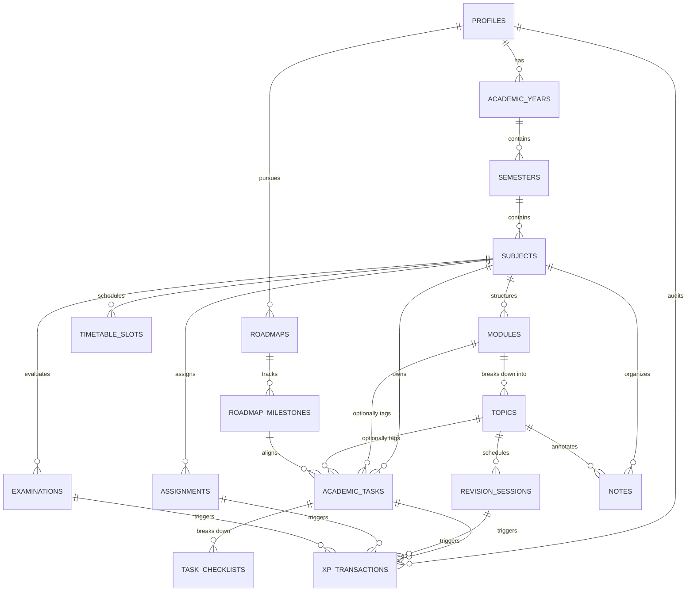

# Questly 2.0 — Academic Data Model & Schema Specification

**Document Version:** 2.0.0  
**Status:** Approved Architectural Blueprint  
**Target Environment:** Supabase (PostgreSQL 15+) with Strict Row Level Security (RLS)  
**Client Support:** Next.js 16 (TypeScript / `@supabase/ssr`), Flutter 3.38+ (Dart / `supabase_flutter`)

---

## 1. Executive Summary

Questly 2.0 pivots from a generic productivity/fitness checklist into a dedicated **Personal Academic Operating System & Achievement Engine**. This document establishes the normalized academic domain model.

The domain architecture guarantees:
1. **Academic Hierarchy:** `Academic Year` $\to$ `Semester` $\to$ `Subject` $\to$ `Module` $\to$ `Topic` $\to$ `Academic Task` $\to$ `Checklist Item`.
2. **Academic Deadlines & Milestones:** `Assignments`, `Examinations`, and `Timetable Slots`.
3. **Cognitive Retention:** Spaced repetition `Revision Sessions` based on SM-2 / Leitner intervals.
4. **Authoritative Ledger Integration:** Direct linkage to `xp_transactions` and `activity_logs` with complete idempotency and zero-tampering guarantees.
5. **Data Preservation:** Full backward compatibility with existing generic `goals` and `notes` through non-destructive foreign key references.

---

## 2. Entity-Relationship Diagram (ERD)



---

## 3. Normalized Table Specifications

### 3.1. `academic_years`
Represents an academic calendar cycle (e.g., "2026-2027", "Sophomore Year").

| Column | Type | Constraints | Description |
| :--- | :--- | :--- | :--- |
| `id` | `UUID` | `PRIMARY KEY DEFAULT gen_random_uuid()` | Unique identifier |
| `user_id` | `UUID` | `REFERENCES profiles(id) ON DELETE CASCADE NOT NULL` | Owner user ID |
| `name` | `VARCHAR(100)` | `NOT NULL` | Name (e.g., "Year 2 (2026-2027)") |
| `start_date` | `DATE` | `NOT NULL` | Calendar start date |
| `end_date` | `DATE` | `NOT NULL` | Calendar end date |
| `is_current` | `BOOLEAN` | `DEFAULT false NOT NULL` | Active academic year flag |
| `created_at` | `TIMESTAMPTZ` | `DEFAULT now() NOT NULL` | Record creation timestamp |
| `updated_at` | `TIMESTAMPTZ` | `DEFAULT now() NOT NULL` | Record modification timestamp |

### 3.2. `semesters`
Represents a sub-term within an academic year (e.g., "Semester 3", "Spring 2026").

| Column | Type | Constraints | Description |
| :--- | :--- | :--- | :--- |
| `id` | `UUID` | `PRIMARY KEY DEFAULT gen_random_uuid()` | Unique identifier |
| `user_id` | `UUID` | `REFERENCES profiles(id) ON DELETE CASCADE NOT NULL` | Owner user ID |
| `academic_year_id` | `UUID` | `REFERENCES academic_years(id) ON DELETE CASCADE NOT NULL` | Parent academic year |
| `name` | `VARCHAR(100)` | `NOT NULL` | Semester name (e.g., "Semester 3") |
| `start_date` | `DATE` | `NOT NULL` | Semester start date |
| `end_date` | `DATE` | `NOT NULL` | Semester end date |
| `is_current` | `BOOLEAN` | `DEFAULT false NOT NULL` | Active semester flag |
| `target_gpa` | `NUMERIC(3,2)` | `CHECK (target_gpa >= 0.0 AND target_gpa <= 10.0)` | Target GPA (e.g., 9.20 or 3.85) |
| `actual_gpa` | `NUMERIC(3,2)` | `CHECK (actual_gpa >= 0.0 AND actual_gpa <= 10.0)` | Attained GPA |
| `created_at` | `TIMESTAMPTZ` | `DEFAULT now() NOT NULL` | Timestamp |
| `updated_at` | `TIMESTAMPTZ` | `DEFAULT now() NOT NULL` | Timestamp |

### 3.3. `subjects`
Academic courses registered within a semester (e.g., "Data Structures & Algorithms", "Linear Algebra").

| Column | Type | Constraints | Description |
| :--- | :--- | :--- | :--- |
| `id` | `UUID` | `PRIMARY KEY DEFAULT gen_random_uuid()` | Unique identifier |
| `user_id` | `UUID` | `REFERENCES profiles(id) ON DELETE CASCADE NOT NULL` | Owner user ID |
| `semester_id` | `UUID` | `REFERENCES semesters(id) ON DELETE CASCADE NOT NULL` | Parent semester |
| `name` | `VARCHAR(150)` | `NOT NULL` | Course title (e.g., "Algorithms") |
| `code` | `VARCHAR(20)` | `NOT NULL` | Course code (e.g., "CS-204") |
| `instructor_name` | `VARCHAR(100)` | `NULL` | Primary professor or lecturer |
| `color_hex` | `VARCHAR(7)` | `DEFAULT '#A3E635' NOT NULL` | Subject theme accent color |
| `icon_name` | `VARCHAR(50)` | `DEFAULT 'book' NOT NULL` | Lucide icon identifier |
| `credits` | `INT` | `DEFAULT 3 CHECK (credits > 0) NOT NULL` | Credit points |
| `target_grade` | `VARCHAR(5)` | `DEFAULT 'A'` | Target letter/grade point |
| `syllabus_progress` | `NUMERIC(5,2)` | `DEFAULT 0.0 CHECK (syllabus_progress >= 0.0 AND syllabus_progress <= 100.0)` | Syllabus completion percentage |
| `attendance_attended` | `INT` | `DEFAULT 0 CHECK (attendance_attended >= 0)` | Attended classes |
| `attendance_total` | `INT` | `DEFAULT 0 CHECK (attendance_total >= attendance_attended)` | Total conducted classes |
| `min_attendance_req` | `NUMERIC(4,2)` | `DEFAULT 75.0` | Minimum required attendance % |
| `created_at` | `TIMESTAMPTZ` | `DEFAULT now() NOT NULL` | Timestamp |
| `updated_at` | `TIMESTAMPTZ` | `DEFAULT now() NOT NULL` | Timestamp |

### 3.4. `modules` & `topics`
Hierarchical breakdown of course syllabi into learning units.

#### `modules`
| Column | Type | Constraints | Description |
| :--- | :--- | :--- | :--- |
| `id` | `UUID` | `PRIMARY KEY DEFAULT gen_random_uuid()` | Unique identifier |
| `user_id` | `UUID` | `REFERENCES profiles(id) ON DELETE CASCADE NOT NULL` | Owner user ID |
| `subject_id` | `UUID` | `REFERENCES subjects(id) ON DELETE CASCADE NOT NULL` | Parent course |
| `title` | `VARCHAR(200)` | `NOT NULL` | Module name (e.g., "Module 2: Graph Theory") |
| `order_index` | `INT` | `DEFAULT 0 NOT NULL` | Display sequence order |
| `description` | `TEXT` | `NULL` | Module scope notes |
| `created_at` | `TIMESTAMPTZ` | `DEFAULT now() NOT NULL` | Timestamp |
| `updated_at` | `TIMESTAMPTZ` | `DEFAULT now() NOT NULL` | Timestamp |

#### `topics`
| Column | Type | Constraints | Description |
| :--- | :--- | :--- | :--- |
| `id` | `UUID` | `PRIMARY KEY DEFAULT gen_random_uuid()` | Unique identifier |
| `user_id` | `UUID` | `REFERENCES profiles(id) ON DELETE CASCADE NOT NULL` | Owner user ID |
| `module_id` | `UUID` | `REFERENCES modules(id) ON DELETE CASCADE NOT NULL` | Parent syllabus module |
| `title` | `VARCHAR(200)` | `NOT NULL` | Concept title (e.g., "Dijkstra's Shortest Path") |
| `difficulty` | `VARCHAR(20)` | `CHECK (difficulty IN ('beginner','intermediate','advanced')) DEFAULT 'intermediate'` | Difficulty rating |
| `estimated_minutes` | `INT` | `DEFAULT 45 NOT NULL` | Expected study duration |
| `is_completed` | `BOOLEAN` | `DEFAULT false NOT NULL` | Mastery/completion status |
| `completed_at` | `TIMESTAMPTZ` | `NULL` | First completed timestamp |
| `revision_count` | `INT` | `DEFAULT 0 NOT NULL` | Total revision passes conducted |
| `last_revised_at` | `TIMESTAMPTZ` | `NULL` | Last active spaced revision |
| `next_revision_at` | `TIMESTAMPTZ` | `NULL` | Automated spaced repetition trigger |
| `created_at` | `TIMESTAMPTZ` | `DEFAULT now() NOT NULL` | Timestamp |
| `updated_at` | `TIMESTAMPTZ` | `DEFAULT now() NOT NULL` | Timestamp |

### 3.5. `academic_tasks` & `task_checklists`
The day-to-day atomic units of work in Questly.

#### `academic_tasks`
| Column | Type | Constraints | Description |
| :--- | :--- | :--- | :--- |
| `id` | `UUID` | `PRIMARY KEY DEFAULT gen_random_uuid()` | Unique identifier |
| `user_id` | `UUID` | `REFERENCES profiles(id) ON DELETE CASCADE NOT NULL` | Owner user ID |
| `subject_id` | `UUID` | `REFERENCES subjects(id) ON DELETE SET NULL NULL` | Linked course |
| `module_id` | `UUID` | `REFERENCES modules(id) ON DELETE SET NULL NULL` | Optional linked module |
| `topic_id` | `UUID` | `REFERENCES topics(id) ON DELETE SET NULL NULL` | Optional linked topic |
| `milestone_id` | `UUID` | `REFERENCES roadmap_milestones(id) ON DELETE SET NULL NULL` | Optional roadmap link |
| `title` | `VARCHAR(250)` | `NOT NULL` | Actionable task title |
| `description` | `TEXT` | `NULL` | Task details / guidelines |
| `task_type` | `VARCHAR(30)` | `CHECK (task_type IN ('reading','problem_solving','coding','revision','writing','lecture_prep','lab_work','admin')) NOT NULL DEFAULT 'problem_solving'` | Academic task classification |
| `priority` | `VARCHAR(20)` | `CHECK (priority IN ('low','medium','high','urgent')) NOT NULL DEFAULT 'medium'` | Priority level |
| `difficulty` | `VARCHAR(20)` | `CHECK (difficulty IN ('trivial','easy','medium','hard','legendary')) NOT NULL DEFAULT 'medium'` | Difficulty grading |
| `due_date` | `TIMESTAMPTZ` | `NULL` | Due deadline |
| `estimated_minutes` | `INT` | `DEFAULT 30 NOT NULL` | Time block estimate |
| `status` | `VARCHAR(20)` | `CHECK (status IN ('todo','in_progress','completed','archived')) DEFAULT 'todo' NOT NULL` | Task state |
| `completed_at` | `TIMESTAMPTZ` | `NULL` | Exact completion time |
| `xp_reward` | `INT` | `NOT NULL DEFAULT 25` | Base XP allocation |
| `is_xp_awarded` | `BOOLEAN` | `DEFAULT false NOT NULL` | Idempotency guard for ledger |
| `created_at` | `TIMESTAMPTZ` | `DEFAULT now() NOT NULL` | Timestamp |
| `updated_at` | `TIMESTAMPTZ` | `DEFAULT now() NOT NULL` | Timestamp |

#### `task_checklists`
| Column | Type | Constraints | Description |
| :--- | :--- | :--- | :--- |
| `id` | `UUID` | `PRIMARY KEY DEFAULT gen_random_uuid()` | Unique identifier |
| `task_id` | `UUID` | `REFERENCES academic_tasks(id) ON DELETE CASCADE NOT NULL` | Parent task |
| `title` | `VARCHAR(250)` | `NOT NULL` | Subtask item title |
| `is_completed` | `BOOLEAN` | `DEFAULT false NOT NULL` | Subtask item state |
| `order_index` | `INT` | `DEFAULT 0 NOT NULL` | Ordering index |
| `completed_at` | `TIMESTAMPTZ` | `NULL` | Subtask completion time |

### 3.6. `assignments` & `examinations`

#### `assignments`
| Column | Type | Constraints | Description |
| :--- | :--- | :--- | :--- |
| `id` | `UUID` | `PRIMARY KEY DEFAULT gen_random_uuid()` | Unique identifier |
| `user_id` | `UUID` | `REFERENCES profiles(id) ON DELETE CASCADE NOT NULL` | Owner user ID |
| `subject_id` | `UUID` | `REFERENCES subjects(id) ON DELETE CASCADE NOT NULL` | Associated course |
| `title` | `VARCHAR(200)` | `NOT NULL` | Assignment title |
| `description` | `TEXT` | `NULL` | Assignment brief / requirements |
| `weightage_percentage` | `NUMERIC(4,2)` | `DEFAULT 5.0` | Contribution to final grade (%) |
| `deadline` | `TIMESTAMPTZ` | `NOT NULL` | Submission deadline |
| `status` | `VARCHAR(20)` | `CHECK (status IN ('not_started','in_progress','submitted','graded')) DEFAULT 'not_started' NOT NULL` | Lifecycle state |
| `max_score` | `NUMERIC(5,2)` | `DEFAULT 100.0` | Maximum points |
| `obtained_score` | `NUMERIC(5,2)` | `NULL` | Achieved score |
| `created_at` | `TIMESTAMPTZ` | `DEFAULT now() NOT NULL` | Timestamp |
| `updated_at` | `TIMESTAMPTZ` | `DEFAULT now() NOT NULL` | Timestamp |

#### `examinations`
| Column | Type | Constraints | Description |
| :--- | :--- | :--- | :--- |
| `id` | `UUID` | `PRIMARY KEY DEFAULT gen_random_uuid()` | Unique identifier |
| `user_id` | `UUID` | `REFERENCES profiles(id) ON DELETE CASCADE NOT NULL` | Owner user ID |
| `subject_id` | `UUID` | `REFERENCES subjects(id) ON DELETE CASCADE NOT NULL` | Subject being tested |
| `title` | `VARCHAR(200)` | `NOT NULL` | Examination title (e.g., "Midterm Exam") |
| `exam_type` | `VARCHAR(20)` | `CHECK (exam_type IN ('quiz','midterm','endsem','mock','viva','practical')) DEFAULT 'midterm' NOT NULL` | Exam categorization |
| `exam_date` | `TIMESTAMPTZ` | `NOT NULL` | Scheduled date and time |
| `duration_minutes` | `INT` | `DEFAULT 120 NOT NULL` | Exam time limit |
| `room_location` | `VARCHAR(100)` | `NULL` | Exam hall or building |
| `weightage_percentage` | `NUMERIC(4,2)` | `DEFAULT 30.0` | Final score weightage % |
| `syllabus_covered` | `TEXT` | `NULL` | Modules/chapters tested |
| `max_marks` | `NUMERIC(5,2)` | `DEFAULT 100.0` | Total marks |
| `target_marks` | `NUMERIC(5,2)` | `DEFAULT 85.0` | Goal score |
| `marks_obtained` | `NUMERIC(5,2)` | `NULL` | Actual attained score |
| `created_at` | `TIMESTAMPTZ` | `DEFAULT now() NOT NULL` | Timestamp |
| `updated_at` | `TIMESTAMPTZ` | `DEFAULT now() NOT NULL` | Timestamp |

### 3.7. `revision_sessions` (Spaced Repetition Engine)
Tracks spaced repetition intervals using SuperMemo-2 / Leitner Box algorithms.

| Column | Type | Constraints | Description |
| :--- | :--- | :--- | :--- |
| `id` | `UUID` | `PRIMARY KEY DEFAULT gen_random_uuid()` | Unique identifier |
| `user_id` | `UUID` | `REFERENCES profiles(id) ON DELETE CASCADE NOT NULL` | Owner user ID |
| `topic_id` | `UUID` | `REFERENCES topics(id) ON DELETE CASCADE NOT NULL` | Topic under review |
| `repetition_number` | `INT` | `DEFAULT 1 NOT NULL` | Repetition iteration (1, 2, 3...) |
| `ease_factor` | `NUMERIC(4,3)` | `DEFAULT 2.500 NOT NULL` | SM-2 ease multiplier ($\ge 1.3$) |
| `interval_days` | `INT` | `DEFAULT 1 NOT NULL` | Days until subsequent review |
| `scheduled_date` | `DATE` | `NOT NULL` | Due calendar date |
| `completed_at` | `TIMESTAMPTZ` | `NULL` | Session execution time |
| `quality_rating` | `INT` | `CHECK (quality_rating >= 0 AND quality_rating <= 5) NULL` | User recall score (0-5) |
| `created_at` | `TIMESTAMPTZ` | `DEFAULT now() NOT NULL` | Timestamp |

### 3.8. `timetable_slots`
Weekly scheduled lectures, laboratories, and discussion sections.

| Column | Type | Constraints | Description |
| :--- | :--- | :--- | :--- |
| `id` | `UUID` | `PRIMARY KEY DEFAULT gen_random_uuid()` | Unique identifier |
| `user_id` | `UUID` | `REFERENCES profiles(id) ON DELETE CASCADE NOT NULL` | Owner user ID |
| `subject_id` | `UUID` | `REFERENCES subjects(id) ON DELETE CASCADE NOT NULL` | Scheduled subject |
| `day_of_week` | `INT` | `CHECK (day_of_week >= 1 AND day_of_week <= 7) NOT NULL` | 1 = Monday, 7 = Sunday |
| `start_time` | `TIME` | `NOT NULL` | Start time (e.g., 09:00:00) |
| `end_time` | `TIME` | `NOT NULL` | End time (e.g., 10:30:00) |
| `slot_type` | `VARCHAR(20)` | `CHECK (slot_type IN ('lecture','lab','tutorial','seminar','office_hour')) DEFAULT 'lecture' NOT NULL` | Class category |
| `location_room` | `VARCHAR(100)` | `NULL` | Campus room (e.g., "Hall B-201") |
| `instructor_name` | `VARCHAR(100)` | `NULL` | Professor name |
| `created_at` | `TIMESTAMPTZ` | `DEFAULT now() NOT NULL` | Timestamp |

---

## 4. Cross-System Entity Linkages

### 4.1. Linkage to `notes`
The existing `notes` table is enhanced with nullable foreign keys:
```sql
ALTER TABLE notes 
  ADD COLUMN subject_id UUID REFERENCES subjects(id) ON DELETE SET NULL,
  ADD COLUMN topic_id UUID REFERENCES topics(id) ON DELETE SET NULL;
```
This enables:
- Automatic note clustering under subject tabs.
- Quick retrieval of note excerpts directly inside the `Topic` view and `RevisionSession` cards.

### 4.2. Linkage to `roadmaps` & `roadmap_milestones`
Academic roadmaps (e.g., "GATE CS Prep", "Full Stack Development", "Competitive Programming") can link their milestones directly to `academic_tasks`:
```sql
ALTER TABLE academic_tasks
  ADD COLUMN milestone_id UUID REFERENCES roadmap_milestones(id) ON DELETE SET NULL;
```
When an academic task tagged to a milestone is marked complete, the milestone's completion counter recalculates automatically.

### 4.3. Linkage to Authoritative `xp_transactions`
Every XP award is logged through the Postgres stored procedure `award_academic_xp`:
```sql
CREATE OR REPLACE FUNCTION award_academic_xp(
  p_user_id UUID,
  p_amount INT,
  p_source VARCHAR(50),
  p_reference_id UUID,
  p_description TEXT
) RETURNS JSONB ...
```
- Deduplication via `(p_user_id, p_source, p_reference_id)`.
- Re-checking an already rewarded task yields `0 XP`.

---

## 5. Row Level Security (RLS) Implementation Plan

All academic tables inherit the zero-trust multi-tenant security architecture:
1. `ALTER TABLE <table_name> ENABLE ROW LEVEL SECURITY;`
2. Direct owner policy:
   ```sql
   CREATE POLICY "Users own their academic records" ON <table_name>
     FOR ALL TO authenticated
     USING (auth.uid() = user_id)
     WITH CHECK (auth.uid() = user_id);
   ```
3. Child table policy (e.g., `task_checklists`):
   ```sql
   CREATE POLICY "Users own their task checklists" ON task_checklists
     FOR ALL TO authenticated
     USING (EXISTS (
       SELECT 1 FROM academic_tasks t 
       WHERE t.id = task_checklists.task_id AND t.user_id = auth.uid()
     ))
     WITH CHECK (EXISTS (
       SELECT 1 FROM academic_tasks t 
       WHERE t.id = task_checklists.task_id AND t.user_id = auth.uid()
     ));
   ```

---

## 6. Migration & Backward Compatibility Strategy

### Phase 1: Additive Migration (Zero Downtime)
- Run Supabase migration `20261113000001_academic_data_model.sql`.
- Existing `goals` and `habits` tables remain intact and readable.

### Phase 2: Dual-Read Adaptors
- Next.js and Flutter client repositories implement an `AcademicTaskRepository` that wraps both legacy `goals` and new `academic_tasks`.
- Uncategorized legacy tasks surface under an auto-generated "General Studies" subject.

### Phase 3: Non-Destructive Data Archival
- Generic habits (e.g., water drinking, steps) are migrated to an optional `lifestyle_routines` shelf, removing them from the core academic gamification loop while preserving historical streak data.
