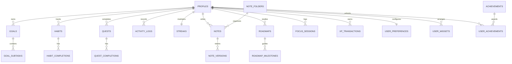

# Questly 2.0 PostgreSQL Database Schema & Security Specification

This document details the PostgreSQL 15+ database architecture implemented for Questly 2.0.

---

## 1. Entity-Relationship Overview

---

## 2. Table Specifications

### 2.1 Core Identity & Preferences
* **`profiles`**:
  * Extends `auth.users` on `id` (UUID).
  * Fields: `username`, `display_name`, `avatar_url`, `bio`, `level` (computed), `total_xp` (authoritative total).
  * RLS: Publicly readable; update restricted to `auth.uid() = id`.
* **`user_preferences`**:
  * Fields: `theme` (dark/light/system), `accent_color` (lime/lavender/blue/orange), `density`, `typography`, `timezone`, `week_start`, `date_format`, `reduced_motion`, `sound_enabled`.
  * RLS: Owner only.

### 2.2 Productivity & Tasks
* **`goals` & `goal_subtasks`**:
  * Hierarchical goal planning with nested checklists, priority (1-5), difficulty tiers (`easy`, `medium`, `hard`, `epic`), and deadline triggers.
* **`habits` & `habit_completions`**:
  * Recurring habits with day-of-week target masks (`mon`, `tue`, etc.) and unique date constraint on completions.
* **`quests` & `quest_completions`**:
  * Gamified micro-missions with difficulty and XP rewards.

### 2.3 Consistency & Analytics
* **`activity_logs`**:
  * Unified log of every completed action across Quests, Habits, Goals, Focus Sessions, and Mind Snap Arcade.
  * Fields: `activity_type`, `category`, `title`, `activity_date`, `xp_earned`, `duration_minutes`, `metadata`, `idempotency_key`.
  * Unique constraint on `(user_id, idempotency_key)` guarantees zero duplicate records on retried syncs.
* **`daily_summaries`**:
  * Aggregated daily statistics per user per date: total XP, focus minutes, activities count, and category breakdown.
* **`streaks`**:
  * Manages active and longest streaks, last active date, remaining streak freezes, and recovery days.

### 2.4 Knowledge & Notes
* **`notes`**, **`note_folders`**, **`note_tags`**, **`note_versions`**:
  * Full hierarchical notebook with Markdown support, pinning, tagging, and version history.
  * Links bi-directionally to `linked_goal_ids` and `linked_roadmap_ids`.

### 2.5 Focus & Gamification
* **`focus_sessions`**:
  * Deep work Pomodoro records with duration in minutes and idempotency keys.
* **`achievements` & `user_achievements`**:
  * Tiered achievements: Bronze, Silver, Gold, Diamond, Legendary.
* **`xp_transactions`**:
  * Immutable, auditable XP transaction ledger. The total XP in `profiles` is calculated from validated transactions.
* **`user_widgets`**:
  * Custom in-app dashboard layout (visibility, order, size, and widget configuration).

---

## 3. Server-Side Security Functions

### `record_activity_and_award_xp(...)`
A PostgreSQL function declared as `SECURITY DEFINER` that:
1. Verifies that `auth.uid() = p_user_id`.
2. Inserts into `activity_logs` with `ON CONFLICT (user_id, idempotency_key) DO NOTHING`.
3. If duplicate, returns immediate status without awarding extra XP.
4. Inserts into `xp_transactions`.
5. Updates `profiles.total_xp` and recalculates `profiles.level = FLOOR(SQRT(total_xp / 100)) + 1`.
6. Upserts `daily_summaries`.
7. Calls `recalculate_user_streak()`.
