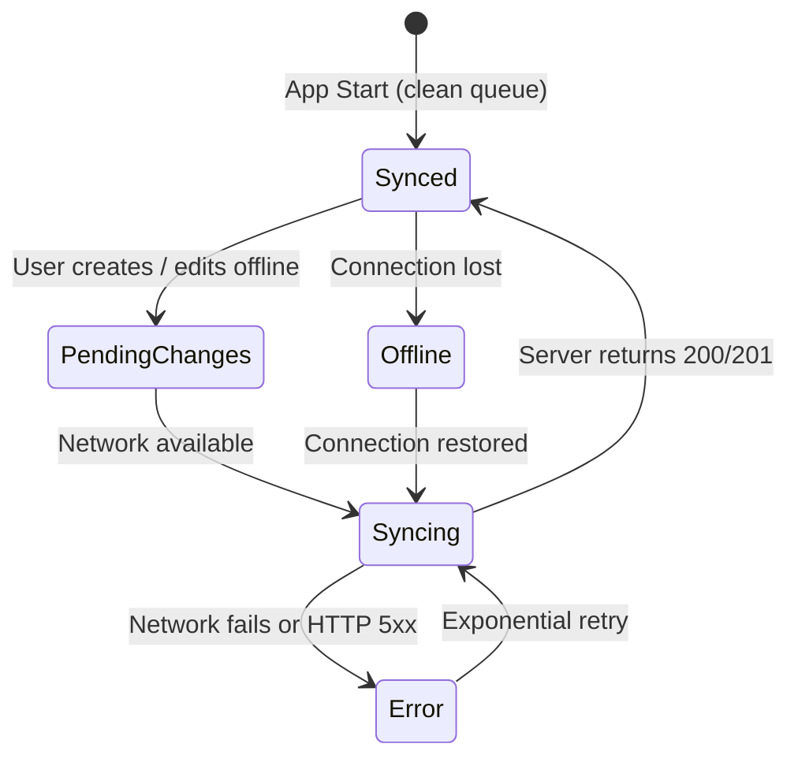

# Questly 2.0 Offline-First Synchronization & Architecture

This document specifies the bidirectional offline synchronization architecture for Questly 2.0.

---

## 1. Architectural Principles

1. **Local-First Availability**: All user actions (creating goals, completing quests, checking off subtasks, taking notes, logging focus sessions) write immediately to local persistent storage. The UI responds with zero perceived latency.
2. **Deterministic Idempotency**: Every syncable action is assigned a client-generated UUID v4 `idempotency_key`. The PostgreSQL backend enforces uniqueness on `(user_id, idempotency_key)`, preventing accidental double-awarding of XP or duplicate activity records.
3. **Persistent Sync Queue**: Pending outgoing events are stored in a dedicated queue (`SyncQueue`) that survives app termination and device reboots.
4. **Adaptive Exponential Backoff**: The sync worker employs jittered exponential backoff for failed network calls (`1s`, `2s`, `4s`, `8s`, up to a `60s` ceiling).

---

## 2. Sync States & Transition Graph

---

## 3. Conflict Resolution Policies

| Entity Type | Conflict Resolution Rule | Rationale |
| :--- | :--- | :--- |
| **Activity Logs & XP** | **Append-Only / Idempotent Discard** | Activity logs and XP ledger are strictly immutable. Duplicate submissions with identical `idempotency_key` are acknowledged but ignored. |
| **Notes & Knowledge** | **Last-Write-Wins with Version History** | The server checks `version`. If the client is out of date, a new version snapshot is saved in `note_versions` before merging content. |
| **Habit / Quest Completions** | **Date-Bound Idempotency** | Completions are unique by `(entity_id, date)`. Repeating the same completion on the same calendar day returns the existing record. |
| **Streaks** | **Server Recalculation** | Streaks are computed authoritatively on the server via `recalculate_user_streak()` based on the user's localized activity timestamps. |

---

## 4. Sync Queue Lifecycle

1. **Enqueue**: Action saved locally with status `pending`.
2. **Process**: Worker pulls pending items, marks as `syncing`.
3. **Dispatch**: Transmitted to Supabase REST / Edge Functions.
4. **Success**: Server responds; item marked `synced` and purged during cleanups.
5. **Failure**: Retry count incremented; status set to `failed` with exponential retry scheduled.
