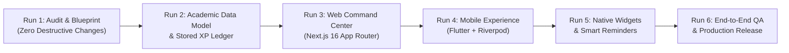

# Questly 2.0 Academic Operating System: 6-Run Product Roadmap

This document outlines the systematic, multi-run execution strategy for transforming Questly into an academic productivity platform.

---

## Roadmap Timeline & Milestone Architecture

---

## Detailed Run Breakdown

### 🎯 Run 1: Product & Codebase Audit (Current Milestone)
* **Goal**: Establish the definitive academic product blueprint without modifying active runtime application logic.
* **Deliverables**:
  * Comprehensive Codebase Audit (`docs/PRODUCT_AUDIT.md`).
  * 53-Item Feature Implementation Matrix (`docs/FEATURE_IMPLEMENTATION_MATRIX.md`).
  * Hierarchical Academic Data Schema (`docs/ACADEMIC_DATA_MODEL.md`).
  * Authoritative XP & Academic Rank Rules (`docs/XP_AND_PROGRESSION.md`).
  * Academic Home-Screen Widget Specification (`docs/WIDGET_ARCHITECTURE.md`).
  * Information Architecture & Wireframe Blueprint (`docs/UX_REDESIGN.md`).
  * Current QA & Verification Metrics (`docs/QA_REPORT.md`).

---

### 🏛️ Run 2: Academic Data Model & Authoritative XP Ledger
* **Goal**: Build the database foundation and server-side RPC validation for structured academic entities.
* **Key Scope**:
  * PostgreSQL Migration (`supabase/migrations/20261114000000_academic_schema.sql`):
    * `academic_years`, `semesters`, `subjects`, `modules`, `topics`, `subtopics`.
    * `assignments`, `examinations`, `revision_sessions`, `timetable_slots`.
  * Server-side functions: `complete_academic_topic()`, `record_assignment_submission()`, `calculate_subject_mastery()`.
  * TypeScript & Dart shared models for academic entities.
  * Unit tests verifying that subtask completions and revisions generate verifiable XP transactions.

---

### 💻 Run 3: Web UX Redesign (Academic Command Center)
* **Goal**: Redesign the Next.js 16 web application into a desktop-optimized academic workspace.
* **Key Scope**:
  * Primary Navigation: `Home`, `Planner`, `Tasks`, `Subjects`, `Focus`, `Roadmaps`, `Insights`, `Profile`.
  * 3-Column Desktop Layout: Collapsible subject rail, main syllabus / task workspace, right-hand deadline & focus rail.
  * Subject Overview & Syllabus Explorer with expandable chapters and subtask checklists.
  * Drag-and-drop weekly planner for study blocks and timetable classes.
  * Markdown knowledge notes linked to specific subjects and topics.

---

### 📱 Run 4: Flutter Mobile Experience (One-Handed Execution)
* **Goal**: Refactor the Flutter mobile client for rapid capture, offline checklist execution, and focus sprints.
* **Key Scope**:
  * One-handed bottom navigation bar with prominent central Quick Capture modal (`+` Task, Note, Assignment).
  * Fast subject-oriented task browsing with tactile spring checkmarks.
  * Integrated Pomodoro Focus Chamber linked to active subject topics.
  * Offline-first synchronization with persistent `SyncQueue` and network status indicators.

---

### 📲 Run 5: Native Widgets & Smart Notifications
* **Goal**: Enable students to track progress and deadlines without launching the application.
* **Key Scope**:
  * Android AppWidget: Today's Tasks, Timetable / Next Class, and Deadline Countdown layouts.
  * iOS WidgetKit: SwiftUI `.systemSmall` and `.systemMedium` widgets with App Group data sharing.
  * Contextual notifications for approaching deadlines and upcoming lectures.
  * In-app widget customization sheet allowing users to configure displayed subjects.

---

### 🛡️ Run 6: Full Integration, End-to-End QA & Release
* **Goal**: Validate data consistency, anti-tampering guards, and cross-platform synchronization.
* **Key Scope**:
  * End-to-end task completion verification: Laptop creation $\to$ Phone offline completion $\to$ Reconnect $\to$ Zero duplicate XP.
  * Automated testing: Flutter test suite, Next.js type check, ESLint, and production build.
  * Multi-viewport visual QA across 390px, 430px, 768px, 1024px, 1440px.
  * Final production deployment checklist.

