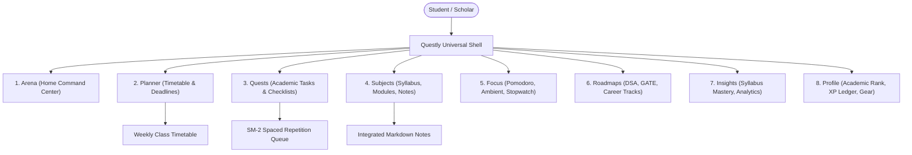

# Questly 2.0 — UX & Information Architecture Redesign

**Document Version:** 2.0.0  
**Design System:** Matiks-Inspired Neo-Brutalist Academic Design Language  
**Target Environments:** Next.js 16 (Responsive Web Desktop & Tablet) & Flutter 3.38+ (iOS & Android Mobile)

---

## 1. Visual Identity & Design Philosophy

Questly 2.0 synthesizes the high-energy, game-like aesthetic of **Matiks** (`https://matiks.com/`) with the rigorous information architecture demanded by a premier academic operating system.

```
+-----------------------------------------------------------------------------------+
|                        QUESTLY 2.0 DESIGN FOUNDATION                              |
+-----------------------------------------------------------------------------------+
|  1. DEEP OBSIDIAN CANVAS      | #09090B backdrop with #121216 bento card surfaces |
|  2. CRISP BORDER DISCIPLINE   | 1.5px solid borders (#27272A) with rounded corners |
|  3. HIGH-VOLTAGE ACCENTS      | Neon Lime (#A3E635) & Academic Lavender (#C084FC)  |
|  4. TACTILE GAME PHYSICS      | Spring physics, micro-haptics, XP particle bursts  |
|  5. COGNITIVE CLARITY         | Clear three-column desktop and thumb-zone mobile   |
+-----------------------------------------------------------------------------------+
```

### 1.1. Color Palette Tokens
- **Backgrounds:** Canvas `#09090B`, Card Surface `#121216`, Elevated Popover `#18181B`.
- **Borders & Dividers:** Subtle `#27272A`, Focused/Active `#3F3F46`.
- **Primary Interactive (Neon Lime):** `#A3E635` — Call-to-actions, primary buttons, completed task indicators, streak flames.
- **Secondary Academic (Lavender):** `#C084FC` — Academic courses, revision sessions, syllabus tags, subject headers.
- **Functional Accents:**
  - Electric Cyan (`#38BDF8`): Lab work, coding tasks, timetable lectures.
  - Radiant Amber (`#F59E0B`): Upcoming exam countdowns, deadline warnings.
  - Crimson Rose (`#FB7185`): Overdue assignments, urgent high-priority items.

---

## 2. Redesigned Information Architecture (IA)

The information architecture eliminates disconnected features and organizes the student's workflow around their academic semester lifecycle:



---

## 3. Web Command Center Architecture (Desktop & Tablet)

On screens $\ge 1024\text{px}$, Questly utilizes a high-density, three-column responsive grid maximizing workspace utility without clutter.

```
+-----------------------------------------------------------------------------------------------------------+
| TOP BAR: [Logo Questly] [Semester: Sem 3 v]       [Search Cmd+K]       [🔥 18] [⚡ 95 XP] [LVL 14 Scholar] |
+------------------+----------------------------------------------------+-----------------------------------+
| LEFT RAIL (240px)| CENTER WORKSPACE (Flexible, Max 1100px)            | RIGHT RAIL (320px)                |
+------------------+----------------------------------------------------+-----------------------------------+
| > Arena (Home)   | HERO: "Welcome back, Sukrut. 2 classes remaining." | NEXT CLASS                        |
| > Planner        | +------------------------------------------------+ | Operating Systems (CS-301)        |
| > Quests (Tasks) | | TODAY'S TARGET: 4/6 Completed  [=======---] 67% | | Hall B-204 · In 25 min           |
| > Subjects       | +------------------------------------------------+ |                                   |
|   - Algorithms   |                                                    | DEEP FOCUS QUICK-LAUNCH           |
|   - OS           | BENTO GRID:                                        | [ 25:00 Start Pomodoro > ]        |
|   - Linear Alg   | [ Priority Tasks ]      [ Spaced Revision ]        |                                   |
| > Focus          | - Red-Black Trees (CS)  - Dijkstra's Algorithm     | UPCOMING DEADLINES                |
| > Roadmaps       | - Mem Virtualization    - Matrix Eigenvalues       | - Algo PS4 (2 days) [10% Weight]  |
| > Insights       |                                                    | - Midterm Exam (8 days)           |
| > Settings       | SYLLABUS MASTERY RADAR:                            |                                   |
|                  | CS-204 [======----] 62%   CS-301 [========--] 78%  | ACADEMIC RANK CARD                |
|                  |                                                    | Rank: Practitioner (Lvl 14)       |
+------------------+----------------------------------------------------+-----------------------------------+
```

### 3.1. Left Navigation Rail (240px Fixed)
- Pinned at left edge, collapsible to icon-only on tablet view.
- Displays top-level views with badge counts (e.g. `Quests (4)`, `Planner (1)`).
- Quick Course Shelf: Enrolled courses with color-coded badges, providing 1-click access to specific subject syllabus trees.

### 3.2. Center Workspace (Fluid Canvas)
- **Daily Focus Banner:** Dynamic greeting with real-time class status and daily completion progress bar.
- **Academic Tasks Bento:** Grouped by urgency (`Due Today`, `In Progress`, `Revision Due`).
- **Interactive Checkbox:** Neo-brutalist custom checkbox with animated checkmark, haptic tick, and instant local state transition.
- **Subject Mastery Cards:** Interactive progress bars tracking syllabus coverage and next unmastered topic.

### 3.3. Right Intelligence Rail (320px Fixed)
- **Live Class Card:** Real-time countdown to the next scheduled lecture or lab.
- **Focus Timer Widget:** Embedded mini-timer with one-click play/pause and ambient background sound toggles.
- **Deadlines Radar:** Chronological list of upcoming assignments and exams with urgency color indicators.
- **Academic Rank Badge:** Hexagonal badge, XP bar, and streak freeze token count.

---

## 4. Mobile Experience Architecture (Flutter iOS & Android)

The mobile experience is optimized for rapid one-handed interactions, quick task logging between classes, and tactile engagement.

```
+-----------------------------------+
| 09:41                   5G  [98%] |
| Questly               🔥 18  [XP] |
+-----------------------------------+
| [Sumday Showdown Starts In 04:21] |  <-- Academic Tournament / Study Sprint Banner
+-----------------------------------+
| TODAY'S SCHEDULE                  |
| [CS-301] Operating Systems        |
| 10:30 AM · Hall B-204             |
+-----------------------------------+
| TODAY'S QUESTS (4/6)              |
| [ ] Red-Black Tree Implementation |
|     CS-204 · +25 XP · Due 6 PM    |
| [x] Virtual Memory Notes Review   |
|     CS-301 · +15 XP · Completed   |
+-----------------------------------+
| SPACED REVISION DUE TODAY (3)     |
| [ Flashcards: Eigenvalues ]       |
+-----------------------------------+
| [Arena] [Plan]  (+)  [Subj] [More]|  <-- Bottom Navigation Bar
+-----------------------------------+
```

### 4.1. Bottom Navigation Bar (Thumb Zone)
- **Arena (Home):** Daily schedule, active quests, and streak status.
- **Planner:** Weekly class timetable and deadline calendar.
- **Quick Capture `(+)` (Center Floating Trigger):** Raised Neon Lime button (`#A3E635`) that opens the rapid capture sheet.
- **Subjects:** Course directory and syllabus progress trees.
- **More:** Drawer for Focus Timer, Roadmaps, Insights, and Profile.

### 4.2. Rapid Quick-Capture Modal
Triggered in $<100\text{ms}$ upon tapping the central `(+)`:
- Four rapid chips:
  1. `Academic Task`: Title, Subject picker, due time, difficulty.
  2. `Quick Note`: Rich text or Markdown thought snippet linked to course.
  3. `Attendance Log`: Mark present/absent for today's lecture.
  4. `Focus Sprint`: Instantly starts a 25-minute Pomodoro tied to a chosen subject.

### 4.3. Tactile Micro-Interactions & Game Feel
- **Task Completion:** Medium impact haptic feedback, checkmark fill with Neon Lime spring animation, and small floating `+25 XP` badge rising and fading.
- **Streak Flame:** Subtle animated breathing glow on the flame icon when the daily requirement is met.
- **Swipe Actions:** Swipe right to complete, swipe left to reschedule/snooze.

---

## 5. Responsive Breakpoint Matrix

| Screen Width | Target Devices | Layout Configuration |
| :--- | :--- | :--- |
| `< 640px` | Mobile (iOS / Android) | Single column, fixed bottom navigation bar, quick capture bottom sheet |
| `640px - 1023px` | Tablets & Foldables | 2-column layout (collapsible left rail, center workspace with drawer) |
| `1024px - 1439px`| Laptops & Standard Monitors | 3-column layout (240px Left, Flexible Center, 300px Right) |
| `$\ge 1440px$` | Ultra-wide & Large Desktops | 3-column layout (260px Left, Max 1100px Center, 340px Right) |

---

## 6. Accessibility & Inclusivity (WCAG 2.1 AA)

1. **Color Contrast:** All text tokens meet minimum 4.5:1 contrast against `#09090B` and `#121216`. Neon Lime (`#A3E635`) on dark slate exceeds 11:1.
2. **Touch Targets:** All interactive elements on mobile have minimum touch targets of $44 \times 44\text{ pt}$.
3. **Reduced Motion:** Both web (`prefers-reduced-motion: reduce`) and Flutter (`MediaQuery.disableAnimations`) respect user system preferences, replacing spring physics with instant opacity fades.
