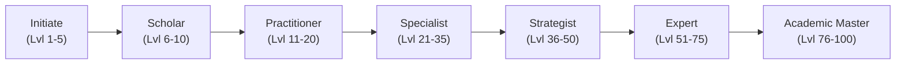

# Questly 2.0 — XP, Academic Progression & Mastery Engine

**Document Version:** 2.0.0  
**Status:** Approved Architectural Specification  
**Authority:** Supabase PostgreSQL Stored Functions & Immutable Audit Ledger  
**Client Frameworks:** Next.js 16 Web Dashboard & Flutter 3.38+ Mobile App

---

## 1. Core Architectural Principle: Effort vs. Competence

Questly 2.0 introduces a strict conceptual and mathematical separation between two fundamental metrics:

```
+----------------------------------------------------------------------------------+
|                              QUESTLY PROGRESSION ENGINE                          |
+-------------------------------------------------+--------------------------------+
|                   EFFORT METRIC                 |        COMPETENCE METRIC       |
|                  XP & LEVEL SYSTEM              |     ACADEMIC MASTERY SCORE     |
+-------------------------------------------------+--------------------------------+
|  * Measures: Volume, consistency, time invested |  * Measures: Syllabus coverage |
|  * Reward: Levels, Titles, Badges, Streaks      |  * Reward: Grade predictability|
|  * Monotonic: Only increases; never decreases   |  * Dynamic: Decays if unrevised|
|  * Formula: Sum of verified action weights      |  * Formula: Multi-factor index |
+-------------------------------------------------+--------------------------------+
```

> [!IMPORTANT]
> **Why this separation is essential:**  
> In generic gamified apps, users fall into the "illusion of competence"—earning hundreds of XP by clicking simple checklists while 70% of their actual syllabus remains untouched. Questly 2.0 ensures that high XP never masks poor syllabus coverage.

---

## 2. Authoritative Academic XP Award Rules

Every XP reward is minted on the backend through the PostgreSQL stored procedure `award_academic_xp`. The client cannot manipulate raw XP balances directly.

| Academic Action | Event Trigger | Base XP | Daily Cap Limit | Verification Criteria |
| :--- | :--- | :---: | :---: | :--- |
| **Atomic Academic Task** | Mark task complete | `+10 XP` | Max 100 XP/day | Must have duration $\ge 15\text{m}$ |
| **Spaced Revision Session** | Complete SM-2 review | `+25 XP` | Max 100 XP/day | Must score recall quality $\ge 3$ |
| **Topic Mastered** | All subtopics complete | `+35 XP` | No limit | One-time per topic ID |
| **Module Completion** | All topics in module complete | `+75 XP` | No limit | One-time per module ID |
| **Assignment Submitted** | Status set to `submitted` | `+40 XP` | No limit | Prior to deadline |
| **High Assignment Score** | Grade verified $\ge 85\%$ | `+20 XP` | No limit | Graded by instructor/user |
| **Mock Examination** | Complete timed practice exam | `+50 XP` | Max 100 XP/day | Session duration $\ge 45\text{m}$ |
| **Deep Focus Pomodoro** | 25-minute Pomodoro block | `+15 XP` | Max 120 XP/day | Continuous timer completion |
| **Focus Milestone** | 2 hours cumulative focus | `+30 XP` | Max 30 XP/day | Daily milestone bonus |
| **Roadmap Milestone** | Complete academic roadmap step | `+50 XP` | No limit | Milestone verification |
| **Daily Streak Bonus** | 7-day streak continuation | `+50 XP` | Once every 7 days | Timezone-validated streak |

---

## 3. Anti-Tampering & Anti-Duplication Safeguards

### 3.1. Database-Enforced Idempotency
All XP awards are logged into the `xp_transactions` audit ledger with an enforced unique composite index:

```sql
CREATE UNIQUE INDEX idx_xp_deduplication 
  ON xp_transactions (user_id, source, reference_id) 
  WHERE reference_id IS NOT NULL;
```

If a client attempts to submit the same task completion twice:
1. PostgreSQL rejects the insert with a unique constraint violation (`23505`).
2. The user's total XP remains unaltered.
3. The stored procedure returns an idempotent success payload with `{"awarded": 0, "status": "duplicate"}`.

### 3.2. Uncheck & Re-check Safeguards
If a user marks an `academic_task` as uncompleted and re-checks it:
- The task's `is_xp_awarded` boolean flag is checked.
- If `is_xp_awarded = true`, the client UI displays a checkmark, but the backend awards **0 XP**.
- XP cannot be farmed by toggling task checkboxes.

### 3.3. Daily Hard & Soft Caps
To prevent automated scripts or frantic binge-clicking:
- **Daily Hard Cap:** No user may earn more than `600 XP` in any single 24-hour calendar window (calculated in their local timezone).
- Actions beyond the hard cap still log task completion and count toward streak retention, but grant `0 XP`.

---

## 4. Academic Ranks & Level Progression Curve

### 4.1. Level Mathematical Formulation
The XP required to progress from level $L$ to $L + 1$ scales according to a smooth non-linear curve:

$$\text{XP Required for Level } L = \left\lfloor 100 \times (L - 1)^{1.45} \right\rfloor$$

Total cumulative XP required to reach Level $L$:
$$\text{Total XP}(L) = \sum_{k=1}^{L-1} \left\lfloor 100 \times k^{1.45} \right\rfloor$$

### 4.2. Academic Ranks Hierarchy



| Rank Tier | Levels | Cumulative XP | Visual Badge & Border | Student Status Description |
| :--- | :---: | :---: | :--- | :--- |
| **Initiate** | $1 - 5$ | $0 - 450$ | Slate / Zinc `#71717A` | Setting up syllabi, learning core habits |
| **Scholar** | $6 - 10$ | $451 - 1,500$ | Soft Lavender `#C084FC` | Consistent daily focus sessions established |
| **Practitioner**| $11 - 20$ | $1,501 - 5,000$ | Electric Cyan `#38BDF8` | Regular spaced revision and problem solving |
| **Specialist** | $21 - 35$ | $5,001 - 12,000$ | Neon Lime `#A3E635` | High syllabus coverage across key semester courses |
| **Strategist** | $36 - 50$ | $12,001 - 23,000$| Radiant Amber `#F59E0B` | Proactive exam prep and assignment milestones |
| **Expert** | $51 - 75$ | $23,001 - 45,000$| Rose Quartz `#FB7185` | Multi-semester retention and academic excellence |
| **Academic Master**| $76 - 100$| $45,001+$ | Obsidian & Holographic Gold | Peak mastery, elite consistency, syllabus completion |

---

## 5. The Academic Mastery Score Specification

The **Academic Mastery Score** is a dynamic index ($0.0\%$ to $100.0\%$) evaluated per subject and aggregated across the semester. Unlike XP, mastery decays if topics are neglected.

### 5.1. Multi-Factor Formula

For any subject $S$, the mastery score $M(S)$ is computed as:

$$M(S) = \left( 0.40 \cdot C_{\text{syllabus}} \right) + \left( 0.25 \cdot E_{\text{exams}} \right) + \left( 0.20 \cdot R_{\text{retention}} \right) + \left( 0.15 \cdot A_{\text{assignments}} \right)$$

Where:
- $C_{\text{syllabus}}$: **Syllabus Coverage Factor**
  $$C_{\text{syllabus}} = \frac{\text{Completed Topics}}{\text{Total Course Topics}} \times 100$$
- $E_{\text{exams}}$: **Examination Performance Factor**
  $$E_{\text{exams}} = \frac{\sum \text{Marks Obtained}}{\sum \text{Max Marks}} \times 100$$
  *(If no exams have occurred yet, this weight redistributes to $C_{\text{syllabus}}$).*
- $R_{\text{retention}}$: **Spaced Repetition Freshness Factor**
  $$R_{\text{retention}} = \frac{\text{Topics Revised Within Scheduled Interval}}{\text{Total Completed Topics}} \times 100$$
  *Topics overdue for revision degrade $R_{\text{retention}}$ by $2.5\%$ per day overdue.*
- $A_{\text{assignments}}$: **Assignment Score Factor**
  $$A_{\text{assignments}} = \frac{\sum \text{Assignment Scores Earned}}{\sum \text{Assignment Max Scores}} \times 100$$

### 5.2. Semester Aggregate Mastery
$$\bar{M}_{\text{semester}} = \frac{\sum_{i=1}^{N} \left( M(S_i) \times \text{Credits}(S_i) \right)}{\sum_{i=1}^{N} \text{Credits}(S_i)}$$

This provides students with an objective, grade-predictive evaluation of their real standing.

---

## 6. Timezone-Aware Streak Logic & Freeze Economy

### 6.1. Timezone Resolution
- Every user profile records `timezone` (e.g. `'Asia/Kolkata'`, `'America/New_York'`).
- The day boundary for streaks is **00:00:00 to 23:59:59 in the user's stored timezone**, not UTC.
- Database evaluation converts UTC timestamps:
  ```sql
  (completed_at AT TIME ZONE p_timezone)::date
  ```

### 6.2. Qualifying Daily Streak Activities
A day is marked active when a user completes at least **one** of the following:
1. Mark at least 1 `academic_task` as complete ($\ge 15\text{m}$ estimated duration).
2. Complete at least 1 `revision_session`.
3. Complete at least 1 full Pomodoro focus block ($25\text{m}$).
4. Submit an `assignment` or record an `examination` score.

### 6.3. Streak Freeze Tokens
- Students maintain up to **2 Streak Freeze Tokens**.
- If a calendar day elapses with no qualifying activity:
  - If `freeze_tokens > 0`: 1 token is consumed, the streak is protected, and a notification alerts the user.
  - If `freeze_tokens = 0`: The streak resets to 0.
- Tokens are restored:
  - Earned automatically upon reaching 14-day and 30-day streak milestones.
  - Purchased using Questly study coins earned through academic achievements.
