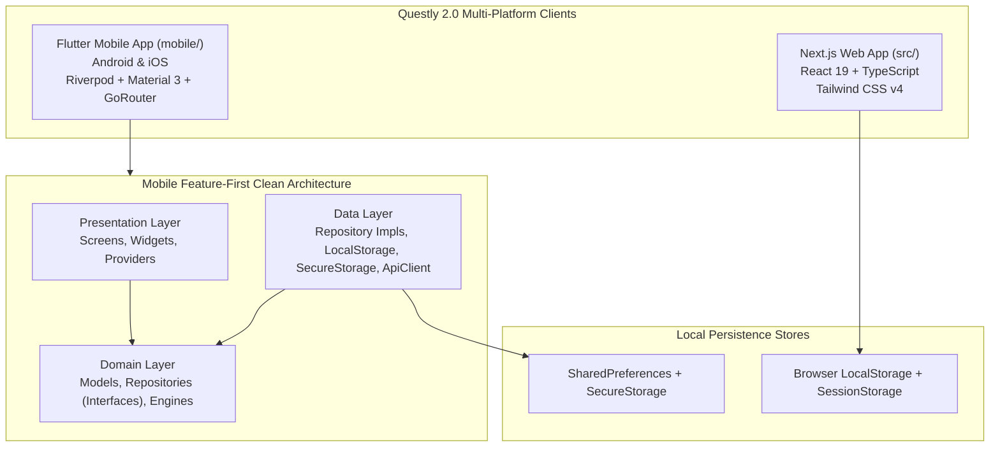

# Questly 2.0 System Architecture

## 1. High-Level System Architecture

Questly 2.0 uses a dual-client, offline-first cross-platform architecture:
- **Mobile Client**: Native Flutter + Dart application for Android and iOS.
- **Web Client**: Modern Next.js + React + TypeScript web application.
- **Shared Data Contracts**: Compatible progression formulas, difficulty curves, and entity schemas.

---

## 2. Mobile Architectural Guidelines (`mobile/`)

### 2.1 Feature-First Clean Architecture
Every feature under `mobile/lib/features/` adheres to a strict 3-tier boundary:

1. **Domain Layer**:
   - Pure Dart entities and data models (e.g. `Quest`, `Note`, `Roadmap`, `FocusSession`, `SkillNode`).
   - Repository interfaces declaring asynchronous contracts (e.g. `QuestRepository`, `NotebookRepository`).
   - Pure business logic engines (e.g. `XpProgressionEngine`, `StreakEngine`).
   - Zero dependencies on Flutter UI frameworks or external network packages.
2. **Data Layer**:
   - Repository implementations (e.g. `QuestRepositoryImpl`, `RoadmapRepositoryImpl`).
   - Serialization / Deserialization (`toJson`, `fromJson`).
   - Local persistence drivers (`LocalStorage`, `SecureStorage`).
   - Remote networking client (`ApiClient` backed by Dio).
3. **Presentation Layer**:
   - State management powered by Riverpod 3 (`Notifier`, `AsyncNotifier`, `Provider`).
   - Screens (`*Screen`), dialogs, and local feature widgets.
   - Design token integration via `AppColors` and `AppTypography`.

### 2.2 Navigation Architecture
GoRouter coordinates all navigation with a 5-branch `StatefulShellRoute.indexedStack`:
1. `/` (`home`): Dashboard & Daily Overview
2. `/quests` (`quests`): Missions, Tasks, and Filters
3. `/insights` (`insights`): Activity Heatmap & Performance Analytics
4. `/notebook` (`notebook`): Personal Knowledge Base & Quick Capture
5. `/roadmaps` (`roadmaps`): Serpentine Goal Paths & Templates

Contextual modal screens (`/focus`, `/notebook/edit/:id`, `/roadmaps/:id`, `/profile`, `/settings`, `/skill-tree`, `/arcade`, `/achievements`) are pushed above the navigation shell using root navigator keys.

---

## 3. Web Architectural Guidelines (`src/`)

- Built using the Next.js App Router (`src/app/`).
- Server & Client Component separation with `'use client'` boundaries for interactive gamification widgets.
- Atomic UI design system with Tailwind CSS v4 utility classes.
- Zero reliance on mobile-specific platform APIs.

---

## 4. Architectural Boundaries

- **No Mobile Code in Web**: `mobile/` is completely self-contained with its own `pubspec.yaml` and Dart toolchain.
- **No Web Code in Mobile**: Web packages in `package.json` never leak into Flutter.
- **Offline Resilience**: Both clients operate flawlessly in zero-connectivity environments with instant optimistic local persistence.

