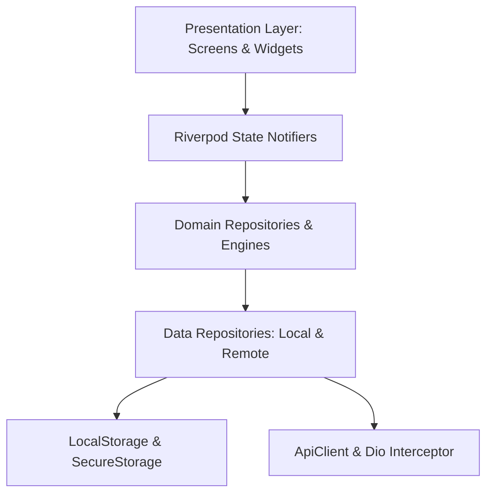

# Questly 2.0 Mobile Architecture

## 1. Architectural Philosophy

Questly 2.0 adopts **Clean Architecture** organized with a **Feature-First** structure. This guarantees strict boundary separation, testability, and horizontal scalability as new gamification modules are added.



---

## 2. Layer Definitions

### 1. Presentation Layer (`features/<feature>/presentation/`)
- **Screens**: Top-level page views bounded by `Scaffold`.
- **Widgets**: Reusable presentational components private to the feature or located in `shared/widgets/`.
- **Providers**: State management utilizing Riverpod `Notifier`, `AsyncNotifier`, and `Provider`. Presentation widgets never perform raw network calls or disk I/O directly.

### 2. Domain Layer (`features/<feature>/domain/`)
- **Entities & Models**: Pure Dart classes representing business concepts (`Quest`, `UserProfile`, `LevelInfo`, `StreakInfo`).
- **Engines**: Deterministic pure business algorithms with zero Flutter UI dependencies (`XpProgressionEngine`, `StreakEngine`).
- **Repository Contracts**: Abstract interfaces specifying data contracts (`QuestRepository`, `DashboardRepository`, `AuthRepository`).

### 3. Data Layer (`features/<feature>/data/`)
- **Repository Implementations**: Implementations of domain repository interfaces coordinating local cache, secure tokens, and remote APIs.
- **Data Sources / Mappers**: Translators converting raw JSON / SQLite maps into strongly-typed domain entities.

### 4. Core Infrastructure (`core/`)
- **`network/`**: `ApiClient`, `ApiInterceptor`, `NetworkInfo`.
- **`storage/`**: `LocalStorage` (wrapping SharedPreferences), `SecureStorage` (wrapping FlutterSecureStorage).
- **`constants/`**: App-wide constants, storage keys, and API paths.
- **`errors/`**: `AppException` and `Failure` hierarchies.
- **`utils/`**: `AppDateUtils`, `Validators`.

---

## 3. Directory Layout

```
mobile/lib/
├── app/
│   ├── app.dart                   # MaterialApp.router configuration
│   ├── bootstrap.dart             # Async initialization & error zoning
│   ├── providers/                 # Core DI providers (ThemeMode, Repositories, Client)
│   ├── router/                    # GoRouter configuration & route definitions
│   └── theme/                     # Design tokens: AppColors, AppTheme, AppTypography, AppSpacing
│
├── config/
│   └── environment.dart           # Dev, Staging, and Production environment configs
│
├── core/
│   ├── constants/                 # App and API constants
│   ├── errors/                    # AppException and Failure types
│   ├── extensions/                # BuildContext convenience extensions
│   ├── network/                   # Dio ApiClient and Auth Interceptor
│   ├── storage/                   # SharedPreferences & SecureStorage wrappers
│   └── utils/                     # Validators, Date formatting, math helpers
│
├── features/
│   ├── dashboard/                 # Gamified productivity dashboard & progression
│   ├── quests/                    # Quest creation, filtering, subtasks
│   ├── tasks/                     # Daily tasks and micro-commitments
│   ├── gamification/              # XP calculation, streaks, Living World stages
│   ├── analytics/                 # Focus analytics and productivity scoring
│   ├── profile/                   # Adventurer stats, theme toggle, badges
│   ├── settings/                  # App preferences and synchronization
│   ├── achievements/              # Unlocked badges and trophies
│   ├── notifications/             # Activity alerts and streak freeze reminders
│   ├── onboarding/                # Intro carousel for new explorers
│   └── auth/                      # Authentication screen & credential injection
│
└── shared/
    ├── enums/                     # Global domain enums (Difficulty, Priority, Stage)
    ├── models/                    # Shared entities (Quest, UserProfile, StreakInfo)
    └── widgets/                   # Reusable components (AppButton, AppCard, AppLoader, etc.)
```

---

## 4. State Management with Riverpod 3.x

Riverpod 3 is utilized without code-generation dependencies for optimal build speed and transparency:
- **`NotifierProvider<ThemeModeNotifier, ThemeMode>`**: Reactive theme management with persistent SharedPreferences synchronization.
- **`AsyncNotifierProvider<DashboardNotifier, DashboardData>`**: Asynchronous dashboard state handling loading, cached data, and error boundaries with pull-to-refresh.
- **`Provider<QuestRepository>`**: Decoupled repository injection allowing effortless test substitution using `overrideWithValue`.

---

## 5. Navigation with GoRouter

Navigation utilizes `go_router` with a root navigator and nested `StatefulShellRoute.indexedStack`:
- Maintains navigation state across the 5 primary tabs: **Home**, **Quests**, **Tasks**, **Analytics**, and **Profile**.
- Root navigator handles modal routes (`createQuest`, `questDetail`, `settings`, `achievements`, `notifications`).
- Deep-linking prepared via centralized `RoutePaths` and `RouteNames`.

